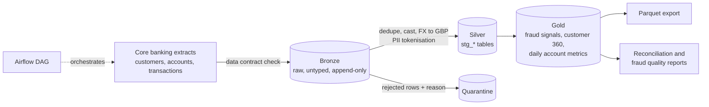

# BankFlow Lakehouse


A production-style **banking data platform you can run on a laptop in one command**.
It models what a retail bank's data engineering team actually has to get right:
medallion architecture, data contracts, quarantine instead of silent drops, PII tokenisation,
reconciliation, orchestration, CI, and fraud analytics that are *measured*, not just demoed.

```bash
pip install -e ".[dev]"
bankflow run-all
```

## Architecture



| Layer | What happens | Where |
|---|---|---|
| Contracts | Required columns validated before anything lands | `contracts/`, `src/bankflow/ingest.py` |
| Bronze | Raw data as VARCHAR, never rejected for typing | `bronze.raw_*` |
| Silver | Dedupe (latest delivery wins), typing, GBP normalisation, PII hashing | `dbt/models/silver` |
| Quarantine | Every rejected row kept with an explicit reason | `silver.quarantine_transactions` |
| Gold | Fraud features, customer 360, daily metrics, reports | `dbt/models/gold` |

## Engineering practices demonstrated

- **Data contracts** per dataset (owner, version, required columns, declared PII columns).
- **Nothing is silently dropped.** Rejected rows are quarantined with a reason, and a dbt test proves
  `bronze rows = duplicates + silver + quarantine`.
- **Governance gate:** a dbt test fails the build if clear-text PII columns ever appear in gold.
- **dbt tests** for uniqueness, nulls, referential integrity and accepted values. `dbt build` stops the
  pipeline on failure, so bad data never reaches the export.
- **Fraud analytics with ground truth.** The generator injects labelled fraud patterns, so the
  detection rules report real recall and precision.
- **Idempotent CLI stages**, reusable from Airflow (`dags/`), CI or cron.
- **CI** on GitHub Actions: lint, unit and end-to-end tests, full pipeline run.

## Fraud rules (gold.fct_fraud_signals)

| Rule | Logic |
|---|---|
| Velocity | 5 or more transactions within +/-10 minutes on one account |
| Amount outlier | Amount at least 4 standard deviations above the account mean |
| Geo hop | Country changes within 60 minutes of the previous transaction |

Thresholds live in `dbt/dbt_project.yml` vars. Scores combine into a severity (`NONE`, `MEDIUM`, `HIGH`).

## Sample output

```
=== Pipeline reconciliation ===
bronze_rows                         48,454
duplicates_removed                     479
silver_rows                         47,278
quarantined_rows                       697

=== Fraud detection quality (vs injected ground truth) ===
pattern            labelled  caught   recall
AMOUNT_OUTLIER           31      31   100.0%
GEO_HOP                  20      20   100.0%
VELOCITY_BURST          279     273    97.8%

Alert precision: 99.1%
```

> The data is synthetic and the injected fraud patterns are deliberately clean, so these
> numbers show the pipeline works, not that the rules would perform this well on real traffic.

## Project layout

```
contracts/      data contracts (YAML)
dags/           Airflow DAG
dbt/            models (silver, gold), seeds, tests, macros
src/bankflow/   generator, contract-validated ingest, CLI
tests/          unit and end-to-end tests
```

## Commands

| Command | Does |
|---|---|
| `bankflow run-all` | generate, ingest, dbt build (models + tests), export, report |
| `bankflow generate --customers 5000 --days 90` | larger dataset |
| `make test` | pytest, including an end-to-end pipeline test |
| `docker build -t bankflow . && docker run bankflow` | containerised run |

## Roadmap

- [ ] Swap DuckDB for Spark + Iceberg/Delta on object storage
- [ ] Streaming ingestion (Kafka) with a trailing-window velocity rule
- [ ] OpenLineage / dbt docs lineage publishing
- [ ] Incremental models and late-arriving data handling
- [ ] ML fraud scoring (gradient boosting) benchmarked against the rules

## Licence

MIT
